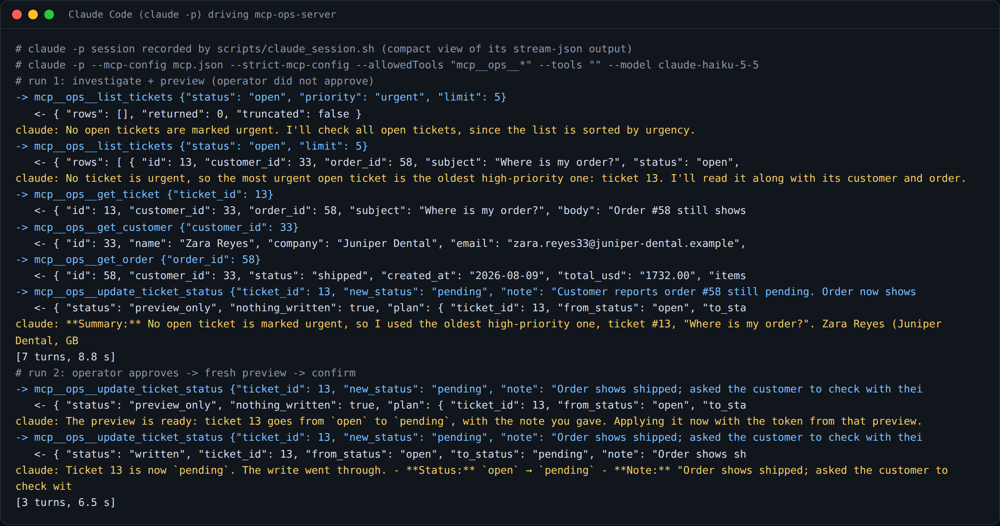
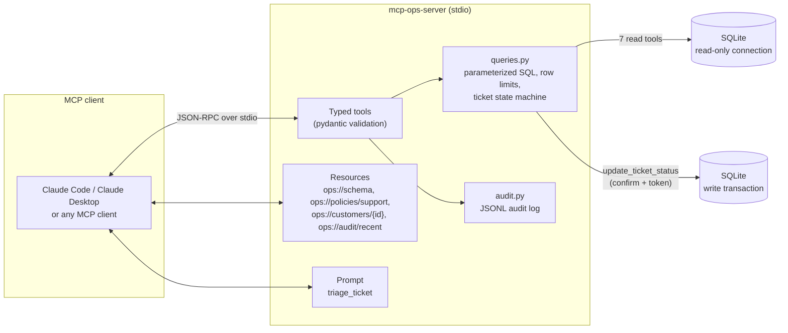
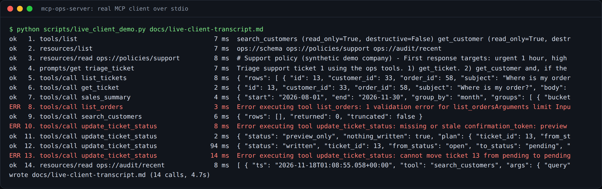

# mcp-ops-server

A custom [Model Context Protocol](https://modelcontextprotocol.io) server that gives Claude **safe, typed access to a business
database**: customers, orders and support tickets. Claude can look things up freely, but it can only change data through
one guarded tool that needs a preview, the user's approval and a confirmation token.

Built on the official `mcp` Python SDK (v2, `MCPServer`, formerly FastMCP). Ships with a SQLite demo database whose
data is **entirely synthetic** (invented names, `.example` email domains).



## The business problem

Support and ops teams want to ask an AI assistant "what's the most urgent open ticket and what did this customer
order?" without copying data around, and without handing the model a raw SQL connection. The usual answers are bad:
a free-form SQL tool (one prompt injection away from `DELETE`), or a pile of untyped endpoints with no audit trail.
This server is a small, reviewable template for the safe version:

| Concern | How this server handles it |
|---|---|
| Model writes bad or malicious SQL | No SQL tool. Fixed, parameterized queries only; `group_by` and sort orders come from whitelists. |
| A read tool is tricked into writing | Reads open SQLite with `mode=ro` **and** `PRAGMA query_only`, so a write raises. |
| Huge result sets flood the context | Every list takes `limit` (1-100, schema-enforced) and returns `truncated: true` when more rows exist. |
| Bad arguments | Typed parameters (ints with ranges, enums, ISO dates, string lengths) validated by pydantic before any query runs. |
| The model changes data on its own | `update_ticket_status` is two-step: preview first (nothing written), then `confirm=true` plus the preview's `confirmation_token`. The token is a fingerprint of the change and the ticket's last update, so a stale or invented token is rejected. |
| Illegal state changes | Ticket status is a state machine (`closed` is final), re-checked inside the write transaction. |
| "Who changed this?" | Every call (read, preview, write, rejection) is appended to a JSONL audit log; writes add a ticket note with the actor. |
| Clients need to know what is safe | MCP tool annotations: reads are `readOnlyHint`, the write is `destructiveHint`. |

## Architecture



## Tools, resources and prompt

| Tool | Kind | What it does |
|---|---|---|
| `search_customers(query, limit)` | read | Substring match on name / company / email (LIKE wildcards escaped) |
| `get_customer(customer_id)` | read | Customer + order count + lifetime value + open ticket ids |
| `list_orders(customer_id?, status?, since?, limit)` | read | Orders newest first, composable filters |
| `get_order(order_id)` | read | Order with line items (money as exact decimal strings) |
| `list_tickets(status?, priority?, customer_id?, limit)` | read | Most urgent and oldest first |
| `get_ticket(ticket_id)` | read | Ticket body and notes |
| `sales_summary(start, end, group_by)` | read | Revenue from paid + shipped orders by day / month / country / plan (max 366 days) |
| `update_ticket_status(ticket_id, new_status, note, confirm=false, confirmation_token="")` | **guarded write** | Preview, then confirm with the token |

Resources: `ops://schema`, `ops://policies/support`, `ops://customers/{customer_id}` (template), `ops://audit/recent`.
Prompt: `triage_ticket(ticket_id)`, a step-by-step triage that ends in a preview and explicitly does not confirm.

## Quickstart

```bash
git clone https://github.com/mhmalvi/mcp-ops-server && cd mcp-ops-server
python3 -m venv .venv && .venv/bin/pip install -e ".[dev]"
.venv/bin/pytest                    # 27 tests: unit + real MCP client sessions over stdio
.venv/bin/python scripts/live_client_demo.py docs/live-client-transcript.md   # scripted client session
```

`mcp-ops-server` seeds `demo.db` with synthetic data on first start. Configuration is by environment variable:
`OPS_DB` (SQLite path, default `demo.db`), `OPS_AUDIT_LOG` (default `audit/audit.jsonl`), `OPS_ACTOR` (author name on notes).

### Claude Code

```bash
claude mcp add ops \
  -e OPS_DB=/absolute/path/demo.db \
  -e OPS_AUDIT_LOG=/absolute/path/audit.jsonl \
  -- /absolute/path/mcp-ops-server/.venv/bin/mcp-ops-server
```

Or headless with a config file, as in the recorded session below:

```bash
cat > mcp.json <<'JSON'
{"mcpServers": {"ops": {"type": "stdio",
  "command": "/absolute/path/mcp-ops-server/.venv/bin/mcp-ops-server",
  "env": {"OPS_DB": "/absolute/path/demo.db", "OPS_AUDIT_LOG": "/absolute/path/audit.jsonl"}}}}
JSON
claude -p --mcp-config mcp.json --strict-mcp-config --allowedTools "mcp__ops__*" \
  "Find the most urgent open ticket and propose a status change. Do not confirm."
```

### Claude Desktop

Add to `claude_desktop_config.json` (Settings > Developer > Edit Config):

```json
{
  "mcpServers": {
    "ops": {
      "command": "/absolute/path/mcp-ops-server/.venv/bin/mcp-ops-server",
      "env": {
        "OPS_DB": "/absolute/path/demo.db",
        "OPS_AUDIT_LOG": "/absolute/path/audit.jsonl"
      }
    }
  }
}
```

## Real results (recorded 2026-11-18 on the build machine)

**1. Scripted MCP client over stdio** (`scripts/live_client_demo.py`, full transcript in
[`docs/live-client-transcript.md`](docs/live-client-transcript.md)):

| Measured | Value |
|---|---|
| MCP requests in the session | 14 (tools/list, resources/list, 2 resource reads, prompts/get, 9 tool calls) |
| Wall-clock incl. server start-up | 4.7 s |
| Per-request latency | 2-14 ms for reads; 94 ms for the committed write |
| Validation rejections shown | `limit: 1000` refused by the schema; `' OR 1=1 --` returns 0 rows; confirm without token refused; repeat confirm refused |



**2. Real Claude Code session** (`scripts/claude_session.sh`: `claude -p --mcp-config`, model `claude-haiku-5-5`, only
`mcp__ops__*` tools available; full transcript in [`docs/claude-code-session.md`](docs/claude-code-session.md), audit
log in [`docs/claude-code-audit.jsonl`](docs/claude-code-audit.jsonl)):

| Run | Prompt | Tool calls Claude made | Turns | Time | Cost reported by Claude Code |
|---|---|---|---|---|---|
| 1 | Find the most urgent open ticket, read ticket + customer + order, preview a change, do not confirm | `list_tickets` x2, `get_ticket`, `get_customer`, `get_order`, `update_ticket_status` (preview) | 7 | 8.8 s | $0.0020 |
| 2 | Operator approves: preview again, then confirm with the token | `update_ticket_status` (preview), `update_ticket_status` (confirm, written) | 3 | 6.5 s | $0.0007 |

In run 1 Claude stopped at the preview as instructed; the database was unchanged until run 2. After run 2 the ticket
was `pending` and its note was authored by `claude-code`. The audit log holds all 8 calls.

## Tests

27 tests, all offline:

- `tests/test_queries.py`: deterministic seed, read-only connection refuses writes, LIKE-wildcard and quote handling,
  row limits and `truncated`, money formatting, order totals vs line items, revenue totals, date-range limits, the
  ticket state machine, and token invalidation after a write.
- `tests/test_stdio_session.py`: spawns the server as a subprocess and talks to it with the real `mcp.Client`
  over stdio: tool list + annotations, typed reads, schema validation errors, preview writes nothing, confirm needs a
  fresh token (and the same token cannot be replayed), closed tickets stay closed, resources, prompt, audit trail.
- `tests/test_audit.py`: append-only log, long arguments clipped.

CI (`.github/workflows/ci.yml`) runs ruff and the whole suite on Python 3.11 and 3.12.

## Limits

- Demo scale: SQLite and a single process. For Postgres you would swap `db.py` and keep the same tool surface; the
  read-only guarantee would come from a read-only database role instead of `mode=ro`.
- stdio transport only (the right default for a local tool). The SDK also serves Streamable HTTP, which would need
  authentication in front of it before leaving localhost.
- The confirmation token proves the confirm matches a fresh preview; it does not prove a *human* approved it. That
  approval lives in the client (Claude Code's permission prompt or your own UI). The audit log makes the outcome reviewable.
- One guarded write tool by design. Refunds and order edits are deliberately out of scope.
- The data is synthetic and small (40 customers, 160 orders, 60 tickets); latency numbers above are for that size.
- Claude Code's "reported cost" is its own estimate for the session, not an invoice.

## License

MIT, see [LICENSE](LICENSE).
